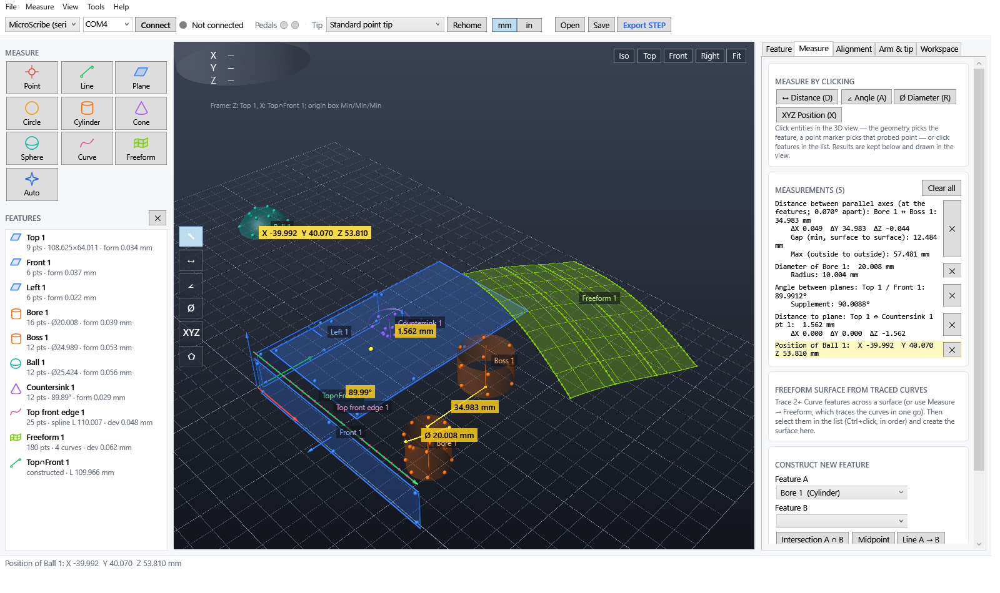
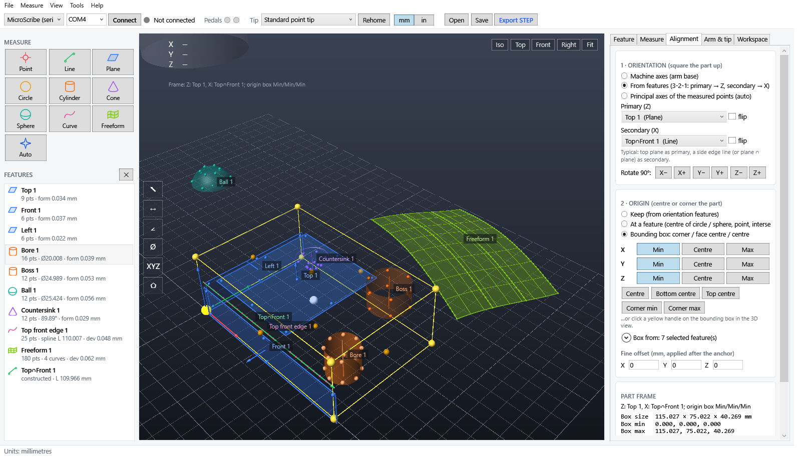
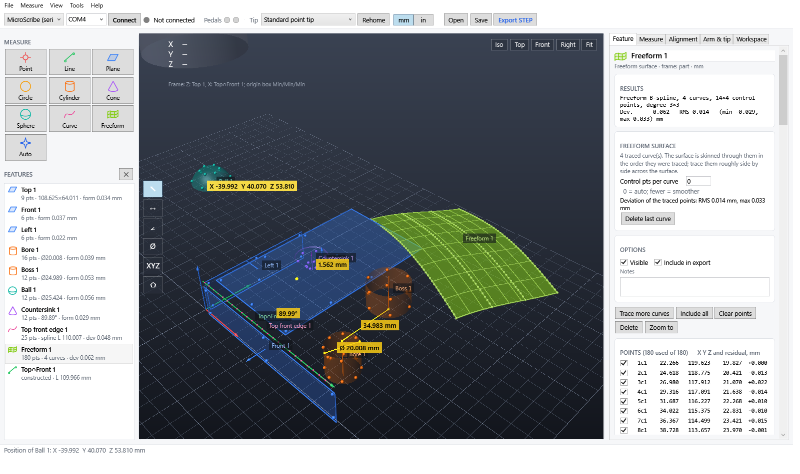
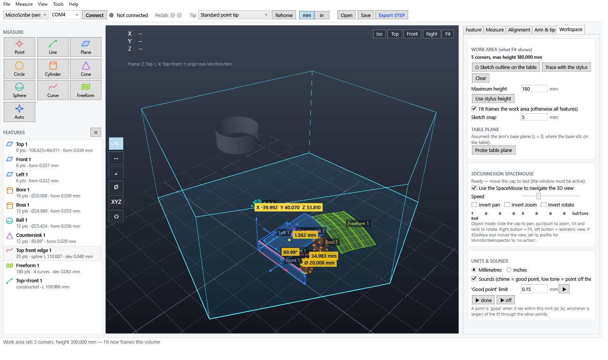

# MicroScribe Inspector

**Open-source measuring and surface-capture software for serial MicroScribe® digitizer arms.**
Probe a part with the arm and foot pedal, fit planes, cylinders, cones, spheres, circles, lines,
curves and freeform surfaces, and export them as real CAD surfaces (STEP) for SolidWorks and other CAD
systems.

**⬇ Download:** [MicroScribeInspector-portable.zip](dist/MicroScribeInspector-portable.zip) —
unzip anywhere and run `MicroScribeInspector.exe` (Windows 10/11, nothing to install).



MicroScribe Inspector is an independent alternative for these older serial arms, made for owners who
have found the original software difficult to run on modern operating systems. Its serial driver is
written from **public protocol documentation** and **observation of the device itself** (see
[How it works](#how-it-works)), so it runs on its own without any other software installed.

> Not affiliated with, endorsed by or supported by the owner of the MicroScribe trademark.
> See [LEGAL.md](LEGAL.md).

## Features

| Area | What you get |
|---|---|
| Driver | Own implementation of the arm's serial protocol: sign-on/autobaud, identification, reading the arm's stored calibration, encoder resolution, foot pedals, re-home, recovery after cable glitches. Read-only — it never writes to the arm's memory. |
| Measuring | Point, line, plane, circle, cylinder, cone, sphere, traced curve, **freeform surface** (trace several curves), and auto-detect. Averaged captures that are rejected if the stylus moved, optional hands-free capture (hold the stylus still), per-point residuals, outlier exclusion, live deviation of the stylus from the selected feature. |
| Feedback | A cheerful chime when a point fits, an arpeggio when a feature finishes cleanly, a low tone when a point is off the fit. |
| Curves | Smoothed spline (within a tolerance) or linear polyline; open or closed. |
| Freeform | Traced curves are skinned into a B-spline surface and exported as a STEP B-spline face. |
| Fitting | Orthogonal least squares (Levenberg–Marquardt), robust axis search for cylinders and cones, form error and RMS, warnings for badly distributed points. |
| Probes | Tip profiles with ball radius and offset, ball compensation for every feature type (including traced curves and freeform surfaces), pivot calibration for custom styli, qualification on a reference sphere. |
| Arm check | Single-point articulation test in a cone seat and a length test on a known bar, with history, pass/fail against your limit and the resulting measuring capability in reports. |
| Measure tools | Click features or single probed points in the 3D view: distance (with ΔX/ΔY/ΔZ and gaps), angle (features or three points), diameter, position. Results stay as labelled dimensions and go into the report. |
| Tolerances | Nominal value and tolerance on any measurement, green/red pass/fail in the view, an out-of-tolerance summary in the report, and a warning when a tolerance is too tight for the arm. |
| GD&T | Flatness, straightness, roundness, cylindricity (least squares or minimum zone), parallelism, perpendicularity, angularity, position and coaxiality, by clicking the feature and its datum. |
| Nominal model | Load an STL of the part, align to it with point pairs and a best fit, see the stylus' live distance from the model, colour probed points by deviation, and check the profile of any feature against it. |
| Planes | Resize by dragging handles or typing a size; extend or trim to another plane so faces meet for knitting. |
| Alignment | 3-2-1 from features or principal axes, 90° turns, origin at a feature or at any bounding-box corner, face centre or centre (clickable handles). |
| View | Work area: sketch the usable table area and a height once, and *Fit* always frames it. 3Dconnexion SpaceMouse navigation. mm / inch toggle. |
| Export | STEP AP214 (analytic and B-spline surfaces plus axes, centres, curves), CSV, XYZ point cloud. Projects are plain XML (`.msproj`). |
| Reports | HTML inspection report with a picture of the view, part number / serial / operator, logo, pass/fail summary and results table (print it to PDF from the browser); text report; a CSV results log that collects many parts. |
| Portable | One small `.exe`, no installation needed; optional per-user install (Start menu, file association, uninstall entry) with no admin rights. |

| | |
|---|---|
|  |  |
| Square the part up and put the origin on a corner or centre | Freeform surface skinned through traced curves |
|  | |
| The sketched work area that *Fit* frames | |

## Hardware

| Device | Status |
|---|---|
| MicroScribe 3DX (model DX, parameter format "DH0.5", firmware "HCI 2.0") | **Tested** — positions verified on real hardware |
| Other serial MicroScribe-3D family arms (3D, 3DLX, …) | Should work (same protocol family) — untested, reports welcome |
| USB-only models | Not supported (different interface) |

Connect the arm's RS-232 port directly or through a USB-serial adapter (CH340 tested) and plug the
foot pedal into the arm.

## Getting started

1. Download [the portable zip](dist/MicroScribeInspector-portable.zip) (also attached to each release)
   and unzip it anywhere, or build from source (below).
2. Put the arm in its **home pose** (resting in the base cradle) and switch it on. The encoders zero at power-up.
3. Run `MicroScribeInspector.exe`, pick the COM port and press **Connect**.
4. Pick a feature type on the left, or just press the pedal and let **Auto** classify the points.
   **Pedal 1 / Space** captures, **pedal 2 / Enter** finishes, **Backspace** undoes, **Esc** cancels.
5. **Alignment** tab: square the part up and put the origin where you want it in CAD.
6. **File → Export STEP**, then open the file in your CAD system. In SolidWorks, enable
   *Import free point/curve entities* to also get axes, centres and curves.

No arm at hand? Choose **Simulator** in the driver box to probe a virtual test block.

Optional: *Tools → Install on this PC* adds a Start-menu shortcut and `.msproj` association for the
current user. Uninstall from *Apps & features*.

## How it works

The arm speaks a simple byte-oriented serial protocol. Everything this project relies on comes from:

* the MIT-licensed open-source **[microcmm](https://github.com/Revise-Robotics/microcmm)** Python driver,
* the open-source **[VRPN](https://github.com/vrpn/vrpn)** device library, and
* our own **observation of the arm's replies** using read-only commands.

The arm stores its own calibration (Denavit–Hartenberg link parameters) and sends it on request;
positions are computed from that and the joint encoders. [docs/PROTOCOL.md](docs/PROTOCOL.md) documents
the protocol and the kinematics, with the source of every statement.

## Building from source

Windows 10/11 only. No SDK or Visual Studio needed — the build uses the C# compiler that ships with
the .NET Framework in Windows.

```bat
powershell -ExecutionPolicy Bypass -File build.ps1          :: app + tools + tests -> bin\
bin\tools\MsTests.exe                                       :: self-tests (fitting, export, ...)
powershell -ExecutionPolicy Bypass -File package.ps1        :: dist\ folder + portable zip
```

`bin\tools\MsProbe.exe info COM4` identifies a connected arm and prints its decoded calibration and live
samples (`scan` tries every baud rate, `stream` shows live positions and pedal events). It only uses
read-only commands.

## Project layout

```
src/Core        Vec3 / Mat4
src/Driver      serial protocol, arm kinematics, device polling
src/Geometry    fitting, freeform, constructions, alignment, dimensions, project model
src/Export      STEP writer, CAD export, CSV / XYZ / report
src/App         WPF application (code-only UI), simulator, SpaceMouse, sounds, installer
src/Tools       MsProbe hardware probe
src/Tests       self-checking tests
docs/           PROTOCOL.md and screenshots
```

## Roadmap

The full plan, in the order it is worked on, is in [ROADMAP.md](ROADMAP.md). In short — contributions welcome:

1. **Trustworthy numbers** — ball compensation everywhere, movement check and hands-free capture,
   probe qualification on a reference sphere, an arm check (articulation and length tests).
2. **Inspection against nominal values** — tolerances and pass/fail, basic GD&T, STL nominal model
   with deviation colour map, reports with pictures, learn-and-replay inspection plans with SPC.
3. **Capture and digitizing to CAD** — more scan modes, 2D sketches to DXF, slots and other
   feature types, more constructions, constrained fits, IGES / STL / DXF export.
4. **Larger parts** — leapfrog, temperature correction, faster sampling.

## Contributing

Bug reports, test reports from other arms and pull requests are welcome. Please **do not** submit
manufacturer software, firmware, manuals or material copied from them — see [LEGAL.md](LEGAL.md).

## License

© 2026 Marconnet Technologies.

* **Source code:** [MIT license](LICENSE) — free to use, modify and redistribute; keep the copyright notice.
* **Documentation and images** (this README, [LEGAL.md](LEGAL.md), [docs/](docs/) including the screenshots):
  [Creative Commons Attribution 4.0 (CC BY 4.0)](LICENSE-docs) — free to share and adapt, with credit
  to "© 2026 Marconnet Technologies, MicroScribe Inspector".

MicroScribe is a trademark of its respective owner and is used here only to describe compatibility.
